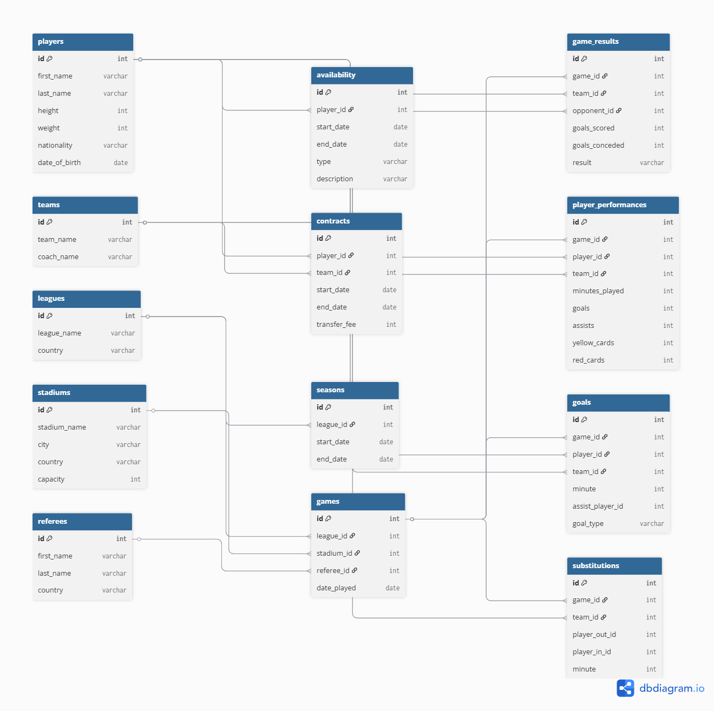

# ⚽ Football League Database

## 📌 Overview
This project is a relational database system designed to manage and analyze a football league.

It demonstrates:
- SQL & data modeling skills
- Scalable database design
- Analytics-ready structure

---

## 🎯 Objectives
- Model a real-world football system
- Ensure data integrity
- Enable analytical queries
- Prepare for future data science use

---

## 🗂️ Database Structure

### Core Entities
- Players
- Teams
- Leagues
- Games
- Player Performances
- Game Results

### Additional Entities
- Contracts
- Availability (injuries/suspensions)
- Goals & Substitutions
- Stadiums & Referees
- Seasons

---

## 🔗 Entity Relationship Diagram

---

## ⚙️ Features

### Data Management
- Insert / update / delete
- Referential integrity (foreign keys)

### Analytics
- League standings
- Top scorers
- Player performance
- Team summaries

---

## 🛠️ Tech Stack
- SQL (PostgreSQL / MySQL)
- Relational modeling

---

## 📂 Structure
/project
- schema.sql
- queries.sql
- DESIGN.md
- README.md
- diagram.png

---

## ▶️ Usage

Create database:
CREATE DATABASE football_league;

Run schema:
psql -d football_league -f schema.sql

Run queries:
psql -d football_league -f queries.sql

---

## 🚧 Limitations
- No real-time updates
- Limited advanced stats
- No ML yet

---

## 🔮 Future Work
- Advanced metrics (xG)
- ETL pipelines
- Dashboards
- Machine learning

---

## 👤 Author
Alex Cabrel Tsapi Koudjou
GitHub: https://github.com/alex-05-20

import dataiku
import pandas as pd

# Read input dataset
input_dataset = dataiku.Dataset("stacked_dataset")
df = input_dataset.get_dataframe()

# Define the two ID columns
id_columns = ["ID1", "ID2"]

# Normalize IDs
for col in id_columns:
    df[col] = df[col].astype("string").str.strip()
    df[col] = df[col].replace("", pd.NA)

# Identify other columns
other_columns = [
    col for col in df.columns
    if col not in id_columns
]

# Normalize empty values
for col in other_columns:
    df[col] = df[col].map(
        lambda x: x.strip() if isinstance(x, str) else x
    )
    df[col] = df[col].replace(
        r"^\s*$", pd.NA, regex=True
    )

# Preserve rows with missing IDs
missing_id_rows = df[
    df[id_columns].isna().any(axis=1)
].copy()

# Rows with both IDs present
valid_df = df[
    df[id_columns].notna().all(axis=1)
].copy()

# Merge function
def merge_values(series):
    values = series.dropna()

    if values.empty:
        return pd.NA

    # Keep first non-empty value
    return values.iloc[0]

# Merge only when BOTH IDs match
if other_columns:
    merged_df = (
        valid_df
        .groupby(id_columns, sort=False, as_index=False)
        .agg({
            col: merge_values
            for col in other_columns
        })
    )
else:
    merged_df = valid_df.drop_duplicates(
        subset=id_columns
    )

# Add rows with missing IDs
unique_ids = pd.concat(
    [merged_df, missing_id_rows],
    ignore_index=True
)

# Preserve original column order
unique_ids = unique_ids[df.columns]

# Write single output
dataiku.Dataset("unique_ids").write_with_schema(unique_ids)

# Summary
print(f"Input rows: {len(df)}")
print(f"Merged records: {len(merged_df)}")
print(f"Rows with missing IDs: {len(missing_id_rows)}")
print(f"Final output rows: {len(unique_ids)}")

