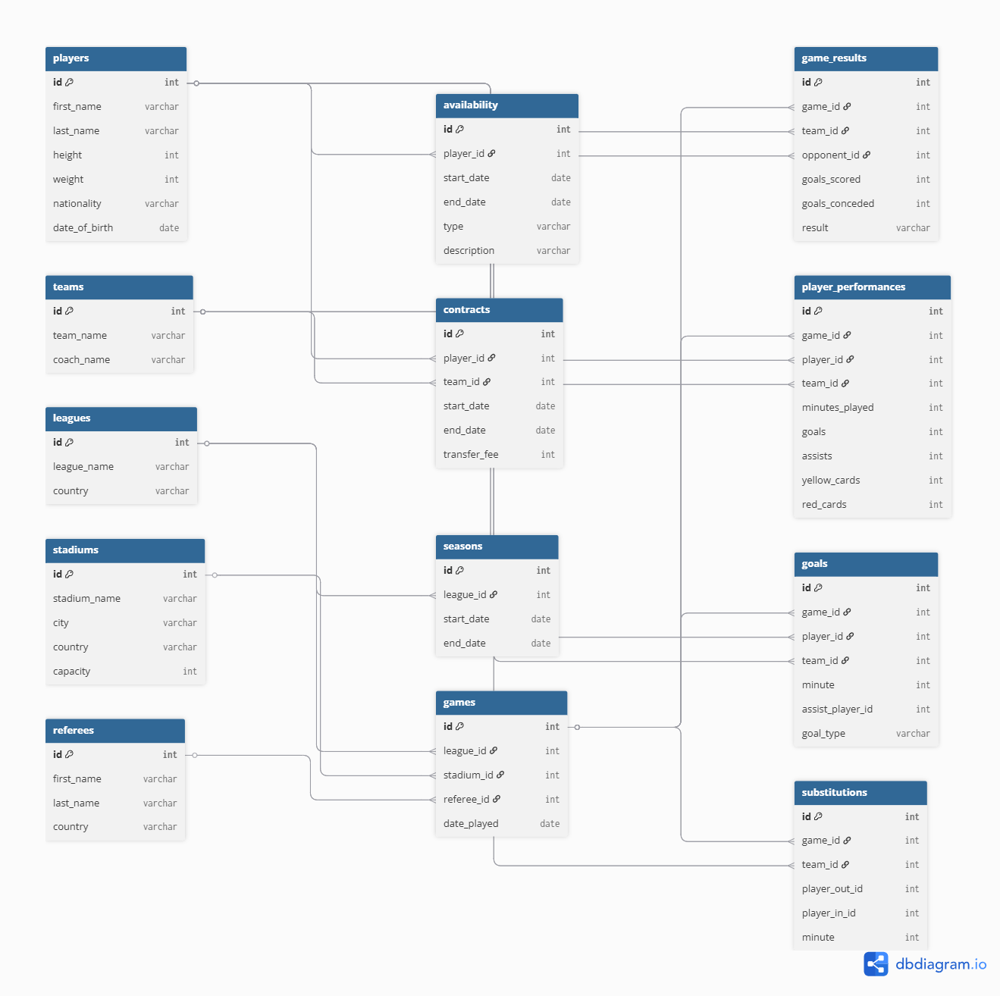

# ⚽ Football League Database

## 📌 Overview
This project is a relational database system designed to manage and analyze a football league.

It demonstrates:
- SQL & data modeling skills
- Scalable database design
- Analytics-ready structure

---

## 🎯 Objectives
- Model a real-world football system
- Ensure data integrity
- Enable analytical queries
- Prepare for future data science use

---

## 🗂️ Database Structure

### Core Entities
- Players
- Teams
- Leagues
- Games
- Player Performances
- Game Results

### Additional Entities
- Contracts
- Availability (injuries/suspensions)
- Goals & Substitutions
- Stadiums & Referees
- Seasons

---

## 🔗 Entity Relationship Diagram

---

## ⚙️ Features

### Data Management
- Insert / update / delete
- Referential integrity (foreign keys)

### Analytics
- League standings
- Top scorers
- Player performance
- Team summaries

---

## 🛠️ Tech Stack
- SQL (PostgreSQL / MySQL)
- Relational modeling

---

## 📂 Structure
/project
- schema.sql
- queries.sql
- DESIGN.md
- README.md
- diagram.png

---

## ▶️ Usage

Create database:
CREATE DATABASE football_league;

Run schema:
psql -d football_league -f schema.sql

Run queries:
psql -d football_league -f queries.sql

---

## 🚧 Limitations
- No real-time updates
- Limited advanced stats
- No ML yet

---

## 🔮 Future Work
- Advanced metrics (xG)
- ETL pipelines
- Dashboards
- Machine learning

---

## 👤 Author
Alex Cabrel Tsapi Koudjou
GitHub: https://github.com/alex-05-20

import dataiku
import pandas as pd

# Read input dataset
input_dataset = dataiku.Dataset("stacked_dataset")
df = input_dataset.get_dataframe()

# Convert IDs to strings for checking
ids = df["ID"].astype("string").str.strip()

# Identify null, empty, HP and GHS IDs
separate_mask = (
    ids.isna()
    | ids.eq("")
    | ids.str.upper().str.startswith(("HP", "GHS"))
).fillna(False)

# Output 1: Valid IDs, deduplicated
unique_ids = (
    df.loc[~separate_mask]
    .drop_duplicates(subset=["ID"], keep="first")
    .reset_index(drop=True)
)

# Output 2: Null, HP and GHS IDs (all retained)
null_ids = (
    df.loc[separate_mask]
    .reset_index(drop=True)
)

# Write outputs
dataiku.Dataset("unique_ids").write_with_schema(unique_ids)
dataiku.Dataset("null_ids").write_with_schema(null_ids)

# Summary
print(f"Total input rows: {len(df)}")
print(f"Unique valid IDs: {len(unique_ids)}")
print(f"Separated rows (null/HP/GHS): {len(null_ids)}")
print(f"Duplicates removed: {len(df) - len(unique_ids) - len(null_ids)}")

